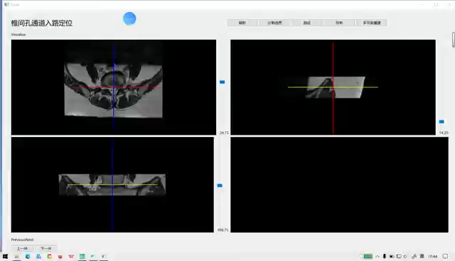
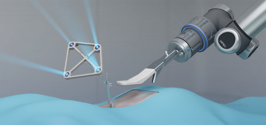
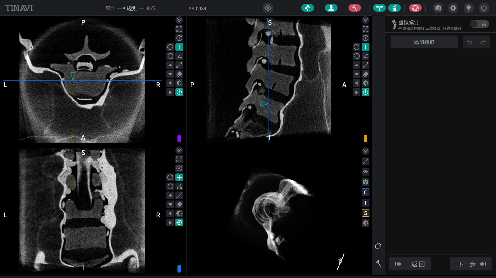
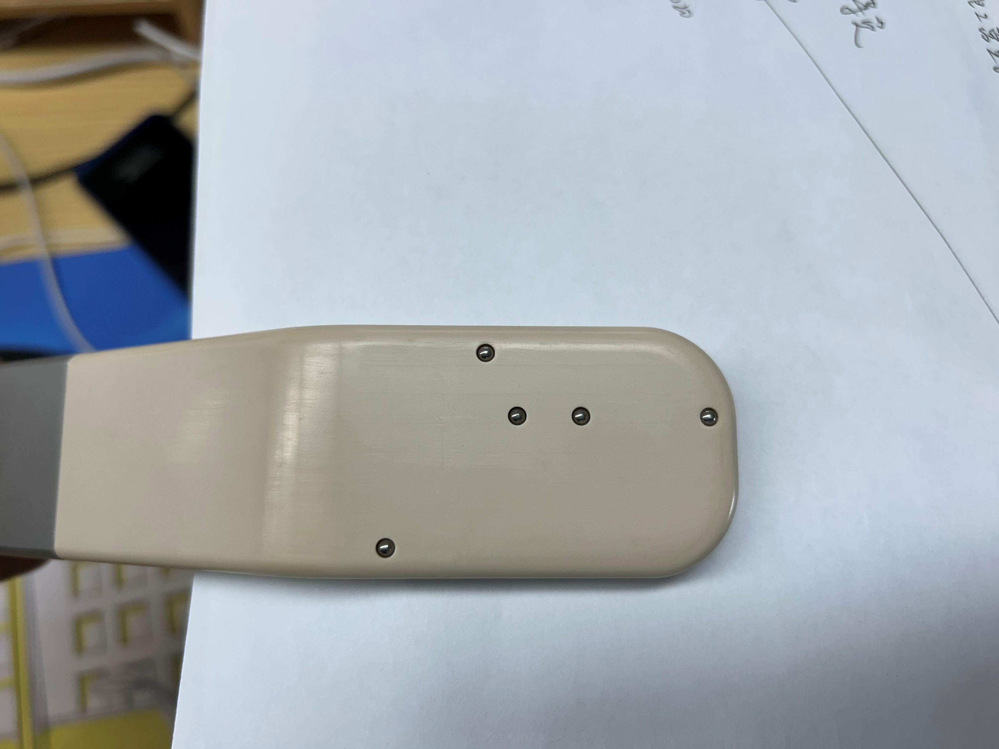
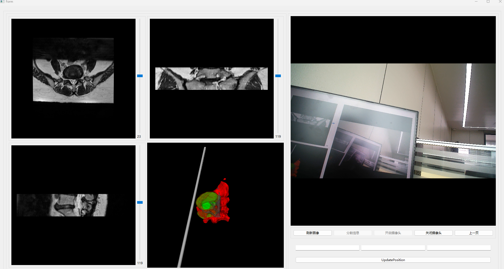

# Lingxi Spine Care Visual Interactive Software Prototype

<div align="center">
  
</div>

一个面向脊柱介入治疗场景的可视化交互软件原型，融合了医学影像显示、路径规划、椎体选择、手术导航和机器人控制辅助等功能，适合用于脊柱外科/医学影像研究和原型演示。

## 项目简介

本项目聚焦于脊柱介入手术辅助场景，主要包含以下能力：

- 医学影像数据的可视化与交互浏览
- 多平面重建与导航定位
- 椎体/病灶目标选择
- 手术路径与入口规划
- 机器人/机械臂辅助控制逻辑
- 面向临床演示的交互式界面

## 功能亮点

### 1. 医学影像交互



- 支持影像序列显示与多视图联动
- 提供基础定位和坐标反馈
- 适合 CT/MRI 等医学图像数据的校准与导航演示

### 2. 椎体路径规划与导航



- 可进行椎体选择与目标定位
- 支持手术路径规划
- 结合图像定位与导航参考线增强可视化效果

### 3. 机器人与手术执行场景



- 面向机器人辅助、术中定位和控制流程的集成
- 便于后续扩展到更完整的外科导航系统
- 适合用于原型验证和演示展示

## 技术栈

- C++ / Qt
- VTK
- NiftyReg
- CMake
- Windows 开发环境

## 目录结构

```text
Project/
├── surgical-robot-software/
│   ├── README.md
│   ├── .gitignore
│   ├── VTK/                     # 预编译 VTK 依赖
│   ├── NiftyReg/                # NiftyReg 相关源码/安装内容
│   ├── data/                    # 数据文件
│   ├── surgical-robot-software-2-0/
│   │   ├── CMakeLists.txt
│   │   ├── main.cpp
│   │   ├── mainwidget.*
│   │   ├── resource/
│   │   └── ...
│   └── assets/
│       └── ppt-images/          # README 使用的 PPT 图像素材
└── ...
```

## 环境说明

本项目依赖如下环境：

- Qt 6.5.3
- VTK 9.2
- CMake 3.16+
- NiftyReg

其中 VTK 已预编译保留在项目目录下的 `VTK/` 中，使用时需要将 `VTK/bin` 加入环境变量。若本机已有其他版本 VTK，建议先确认冲突并避免重复配置。

## 构建说明

1. 进入项目目录：

```bash
cd Project/surgical-robot-software/surgical-robot-software-2-0
```

2. 使用 CMake 配置工程：

```bash
mkdir build
cd build
cmake ..
```

3. 生成并编译：

```bash
cmake --build .
```

4. 运行程序：

```bash
./surgical-robot-software-2-0
```

> Windows 环境下通常使用 Qt Creator + MSVC / CMake 生成器进行构建。确保 VTK 和 NiftyReg 路径与 `CMakeLists.txt` 中的配置一致。

## 设计目标

该软件原型旨在支持：

- 术前规划与术中导航辅助
- 医学影像与机器人控制协同
- 面向临床演示和科研验证的交互界面
- 后续扩展为更完整的脊柱介入手术平台

## 相关截图

<div align="center">
  
</div>

<div align="center">
  
</div>

## 说明

本仓库主要面向软件原型展示与研究开发，部分依赖为本地预编译包或环境依赖，适合在已有 Windows 开发环境中继续扩展和二次开发。

## 许可证

本项目当前用于研究与原型演示，具体授权协议请根据实际使用场景与团队要求确认。

## 联系方式

如需继续扩展该原型、补充更完整的医疗导航逻辑或适配更高版本开发环境，可在本仓库基础上进一步迭代。

